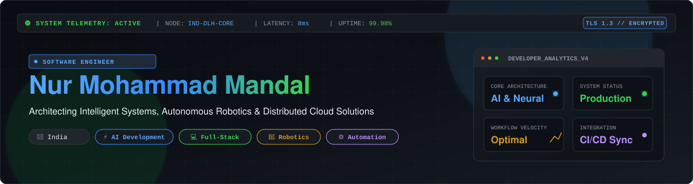
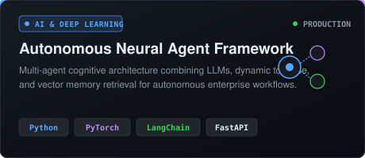
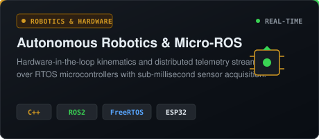
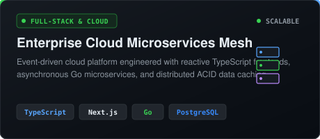
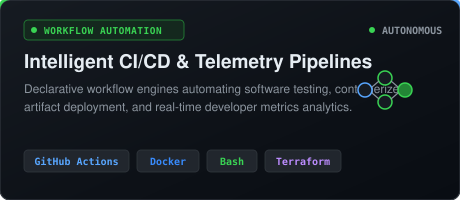
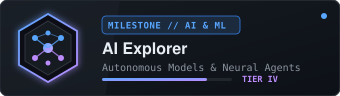
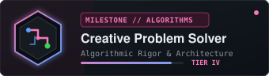
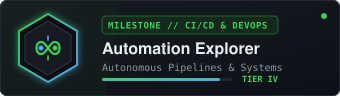

<!--
  =============================================================================
  NUR MOHAMMAD MANDAL — PROFESSIONAL DEVELOPER ANALYTICS DASHBOARD
  Engineered for GitHub Profile: metafixerhub
  Automated via lowlighter/metrics & GitHub Actions
  =============================================================================
-->

  <!-- Top Profile Banner -->
  

 

<!-- =============================================================================
     HERO: LIVE DEVELOPER ANALYTICS ENGINE (LOWLIGHTER/METRICS INFOGRAPHIC)
     ============================================================================= -->

  

 

<!-- =============================================================================
     FEATURED ENGINEERING WORKSPACES & ARCHITECTURAL PROJECTS
     ============================================================================= -->

<h2 align="center" style="color:#58A6FF; border-bottom: 1px solid #30363D; padding-bottom: 8px;">
  🚀 Featured Engineering Projects &amp; Workspaces
</h2>

  Selected open-source initiatives and architectural reference implementations

<table width="100%" border="0" cellpadding="6" cellspacing="0">
  <tr>
    <td width="50%" align="center" valign="top">
      
    </td>
    <td width="50%" align="center" valign="top">
      
    </td>
  </tr>
  <tr>
    <td width="50%" align="center" valign="top">
      
    </td>
    <td width="50%" align="center" valign="top">
      
    </td>
  </tr>
</table>

 

<!-- =============================================================================
     PERSONAL ENGINEERING MILESTONES SHOWCASE
     ============================================================================= -->

<h2 align="center" style="color:#39D353; border-bottom: 1px solid #30363D; padding-bottom: 8px;">
  🎖️ Personal Engineering Milestone Badges
</h2>

  <i>Specialist competency designations and software engineering milestones. Note: These represent individual domain milestones and are curated independently from official GitHub-issued account badges.</i>

<table width="100%" border="0" cellpadding="6" cellspacing="0">
  <tr>
    <td width="50%" align="center">
      
    </td>
    <td width="50%" align="center">
      
    </td>
  </tr>
  <tr>
    <td width="50%" align="center">
      
    </td>
    <td width="50%" align="center">
      
    </td>
  </tr>
  <tr>
    <td width="50%" align="center">
      
    </td>
    <td width="50%" align="center">
      
    </td>
  </tr>
  <tr>
    <td colspan="2" align="center">
      

        
      

    </td>
  </tr>
</table>

 

<!-- =============================================================================
     PROFESSIONAL TELEMETRY FOOTER
     ============================================================================= -->

  

