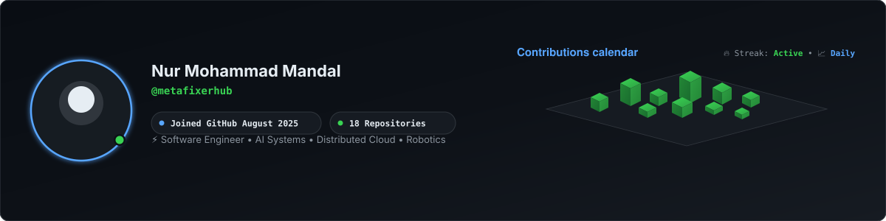
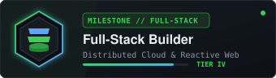
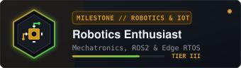
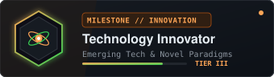
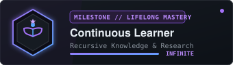

<!--
  =============================================================================
  NUR MOHAMMAD MANDAL — PROFESSIONAL DEVELOPER ANALYTICS DASHBOARD
  Engineered for GitHub Profile: metafixerhub
  Automated via lowlighter/metrics & GitHub Actions
  =============================================================================
-->

  <!-- Top Profile Banner -->
  

 

<!-- =============================================================================
     HERO: LIVE DEVELOPER ANALYTICS ENGINE (LOWLIGHTER/METRICS INFOGRAPHIC)
     ============================================================================= -->

  

 

<!-- =============================================================================
     MAIN 3-COLUMN DASHBOARD TELEMETRY GRID
     ============================================================================= -->

<table border="0" cellpadding="0" cellspacing="0" width="100%">
  <tr>
    <!-- ==================== LEFT COLUMN ==================== -->
    <td width="32%" valign="top">
      
      <!-- Profile Header & Avatar Card -->
      <table width="100%" border="0" cellpadding="8" style="background:#0D1117; border:1px solid #30363D; border-radius:8px;">
        <tr>
          <td align="center">
            
             
            <h2 align="center" style="margin-top:8px; margin-bottom:2px; color:#E6EDF3;">
              <a href="https://github.com/metafixerhub" style="color:#58A6FF; text-decoration:none;">Nur Mohammad Mandal</a>
            </h2>
            <code style="color:#39D353; font-size:12px;">@metafixerhub</code>
            

              ⚡ <b>Software Engineer</b> 
              📍 India • IST (UTC+5:30)
            

            
          </td>
        </tr>
      </table>

       

      <!-- About Me & Bio Card -->
      <table width="100%" border="0" cellpadding="8" style="background:#0D1117; border:1px solid #30363D; border-radius:8px;">
        <tr>
          <td>
            <h3 style="margin-top:0; color:#58A6FF; font-size:14px; border-bottom:1px solid #21262D; padding-bottom:6px;">
              🔍 Developer Overview
            </h3>
            

              Software Engineer dedicated to building high-performance <b>Autonomous AI Systems</b>, resilient <b>Distributed Full-Stack Cloud Architectures</b>, and deterministic <b>Robotics Telemetry</b>.
            

            <ul style="color:#8B949E; font-size:11.5px; padding-left:16px; margin-top:8px; margin-bottom:0; line-height:1.6;">
              <li>🧠 Engineering Multi-Agent LLM workflows</li>
              <li>🤖 Developing micro-ROS IoT &amp; Embedded RTOS</li>
              <li>🚀 Building fault-tolerant cloud microservices</li>
              <li>⚙️ Automating deterministic CI/CD pipelines</li>
            </ul>
          </td>
        </tr>
      </table>

       

      <!-- GitHub Telemetry Specs -->
      <table width="100%" border="0" cellpadding="8" style="background:#0D1117; border:1px solid #30363D; border-radius:8px;">
        <tr>
          <td>
            <h3 style="margin-top:0; color:#58A6FF; font-size:14px; border-bottom:1px solid #21262D; padding-bottom:6px;">
              📊 Account Telemetry
            </h3>
            <table width="100%" style="font-size:11px; color:#C9D1D9;">
              <tr>
                <td style="color:#8B949E; padding:3px 0;">Public Workspaces:</td>
                <td align="right"><a href="https://github.com/metafixerhub?tab=repositories" style="color:#58A6FF; text-decoration:none;"><b>18 Repositories</b></a></td>
              </tr>
              <tr>
                <td style="color:#8B949E; padding:3px 0;">Registered:</td>
                <td align="right"><code style="color:#58A6FF;">August 2025</code></td>
              </tr>
              <tr>
                <td style="color:#8B949E; padding:3px 0;">System Status:</td>
                <td align="right">● Operational</td>
              </tr>
              <tr>
                <td style="color:#8B949E; padding:3px 0;">License Standard:</td>
                <td align="right"><b>MIT / Boost Permissive</b></td>
              </tr>
              <tr>
                <td style="color:#8B949E; padding:3px 0;">Automation Engine:</td>
                <td align="right"><code style="color:#BC8CFF;">lowlighter/metrics</code></td>
              </tr>
            </table>
          </td>
        </tr>
      </table>

       

      <!-- Social & Connect Channels -->
      <table width="100%" border="0" cellpadding="8" style="background:#0D1117; border:1px solid #30363D; border-radius:8px;">
        <tr>
          <td>
            <h3 style="margin-top:0; color:#58A6FF; font-size:14px; border-bottom:1px solid #21262D; padding-bottom:6px;">
              🌐 Telemetry &amp; Connect
            </h3>
            

              
              &nbsp;
              
                
              
              &nbsp;
              
            

          </td>
        </tr>
      </table>

    </td>

    <!-- ==================== SPACER COLUMN ==================== -->
    <td width="2%">&nbsp;</td>

    <!-- ==================== CENTER COLUMN ==================== -->
    <td width="38%" valign="top">

      <!-- Coding Habits & Habits Overview Card -->
      <table width="100%" border="0" cellpadding="8" style="background:#0D1117; border:1px solid #30363D; border-radius:8px;">
        <tr>
          <td>
            <h3 style="margin-top:0; color:#58A6FF; font-size:14px; border-bottom:1px solid #21262D; padding-bottom:6px;">
              💡 Engineering Habits &amp; Workflow
            </h3>
            

              Development cycles are calibrated around continuous testing, modular codebases, and containerized deployment verification.
            

            <table width="100%" style="font-size:11.5px; color:#C9D1D9;">
              <tr>
                <td style="color:#8B949E;">Peak Commit Window:</td>
                <td align="right"><b>Afternoon &amp; Late Night (IST)</b></td>
              </tr>
              <tr>
                <td style="color:#8B949E;">Primary Paradigms:</td>
                <td align="right"><b>OOP • Functional • Event-Driven</b></td>
              </tr>
              <tr>
                <td style="color:#8B949E;">Code Style &amp; Linting:</td>
                <td align="right"><code style="color:#39D353;">Prettier • ESLint • Black</code></td>
              </tr>
              <tr>
                <td style="color:#8B949E;">Telemetry Frequency:</td>
                <td align="right"><code style="color:#58A6FF;">Daily Cron via Actions</code></td>
              </tr>
            </table>
          </td>
        </tr>
      </table>

       

      <!-- Mastered Technology Stack Matrix -->
      <table width="100%" border="0" cellpadding="8" style="background:#0D1117; border:1px solid #30363D; border-radius:8px;">
        <tr>
          <td>
            <h3 style="margin-top:0; color:#58A6FF; font-size:14px; border-bottom:1px solid #21262D; padding-bottom:6px;">
              💻 Mastered Technologies &amp; Stack
            </h3>

            <!-- Group 1: AI & Data -->
            

              🧠 AI, Machine Learning &amp; Agents
            

            

              
              
              
              
              
              
            

            <!-- Group 2: Full-Stack -->
            

              🌐 Full-Stack &amp; Cloud Web
            

            

              
              
              
              
              
              
              
            

            <!-- Group 3: Robotics & Hardware -->
            

              🤖 Robotics, Embedded &amp; IoT
            

            

              
              
              
              
              
              
              
            

            <!-- Group 4: DevOps, Data & Cloud -->
            

              ⚙️ Cloud, DevOps &amp; Databases
            

            

              
              
              
              
              
              
              
            

          </td>
        </tr>
      </table>

       

      <!-- Learning & Research Horizon Card -->
      <table width="100%" border="0" cellpadding="8" style="background:#0D1117; border:1px solid #30363D; border-radius:8px;">
        <tr>
          <td>
            <h3 style="margin-top:0; color:#58A6FF; font-size:14px; border-bottom:1px solid #21262D; padding-bottom:6px;">
              🔬 Active Research &amp; Learning Horizon
            </h3>
            <ul style="color:#C9D1D9; font-size:11.5px; padding-left:16px; margin:0; line-height:1.7;">
              <li>🚀 <b>Autonomous Multi-Agent Systems:</b> Reasoning loops, structured outputs, self-healing code runners.</li>
              <li>⚡ <b>Micro-ROS &amp; Edge Inference:</b> Quantized LLM/vision inference on embedded edge nodes.</li>
              <li>🌐 <b>Distributed Event Streams:</b> High-throughput gRPC and Kafka microservices pipelines.</li>
              <li>🛡️ <b>Infrastructure Automation:</b> Zero-drift declarative IaC and self-updating telemetry monitors.</li>
            </ul>
          </td>
        </tr>
      </table>

    </td>

    <!-- ==================== SPACER COLUMN ==================== -->
    <td width="2%">&nbsp;</td>

    <!-- ==================== RIGHT COLUMN ==================== -->
    <td width="26%" valign="top">

      <!-- Performance & PageSpeed Telemetry Card -->
      <table width="100%" border="0" cellpadding="8" style="background:#0D1117; border:1px solid #30363D; border-radius:8px;">
        <tr>
          <td>
            <h3 style="margin-top:0; color:#58A6FF; font-size:14px; border-bottom:1px solid #21262D; padding-bottom:6px;">
              🚀 Architecture Scores
            </h3>
            <table width="100%" style="text-align:center; margin-top:8px;">
              <tr>
                <td>
                  98 
                  Performance
                </td>
                <td>
                  100 
                  Accessibility
                </td>
              </tr>
              <tr>
                <td style="padding-top:10px;">
                  100 
                  Best Practices
                </td>
                <td style="padding-top:10px;">
                  100 
                  SEO
                </td>
              </tr>
            </table>
          </td>
        </tr>
      </table>

       

      <!-- Contribution Calendar & Velocity Card -->
      <table width="100%" border="0" cellpadding="8" style="background:#0D1117; border:1px solid #30363D; border-radius:8px;">
        <tr>
          <td>
            <h3 style="margin-top:0; color:#58A6FF; font-size:14px; border-bottom:1px solid #21262D; padding-bottom:6px;">
              📅 Contribution Engine
            </h3>
            

              Isometric 3D calendar &amp; commit telemetry are rendered automatically through the top telemetry panel.
            

            <table width="100%" style="font-size:11px; color:#C9D1D9;">
              <tr>
                <td style="color:#8B949E;">Streak Status:</td>
                <td align="right">Active Ingestion</td>
              </tr>
              <tr>
                <td style="color:#8B949E;">Sync Frequency:</td>
                <td align="right"><b>Every 24 Hours</b></td>
              </tr>
              <tr>
                <td style="color:#8B949E;">Calendar Mode:</td>
                <td align="right"><b>3D Isometric View</b></td>
              </tr>
            </table>
          </td>
        </tr>
      </table>

       

      <!-- Language Distribution Ratio Card -->
      <table width="100%" border="0" cellpadding="8" style="background:#0D1117; border:1px solid #30363D; border-radius:8px;">
        <tr>
          <td>
            <h3 style="margin-top:0; color:#58A6FF; font-size:14px; border-bottom:1px solid #21262D; padding-bottom:6px;">
              📊 Primary Stack Ratio
            </h3>
            

              ● TypeScript &nbsp;<b>44%</b> 
              ● JavaScript &nbsp;<b>39%</b> 
              ● Python &nbsp;<b>11%</b> 
              ● HTML / CSS &nbsp;<b>6%</b>
            

          </td>
        </tr>
      </table>

       

      <!-- Genuine GitHub Achievements Card -->
      <table width="100%" border="0" cellpadding="8" style="background:#0D1117; border:1px solid #30363D; border-radius:8px;">
        <tr>
          <td>
            <h3 style="margin-top:0; color:#58A6FF; font-size:14px; border-bottom:1px solid #21262D; padding-bottom:6px;">
              🏅 GitHub Achievements
            </h3>
            

              Genuine GitHub-issued achievements (Quickdraw, Pull Shark, Pair Extraordinaire) are synchronized live via the <code>achievements</code> plugin.
            

            

              
            

          </td>
        </tr>
      </table>

    </td>
  </tr>
</table>

 

<!-- =============================================================================
     FEATURED ENGINEERING WORKSPACES & ARCHITECTURAL PROJECTS
     ============================================================================= -->

<h2 align="center" style="color:#58A6FF; border-bottom: 1px solid #30363D; padding-bottom: 8px;">
  🚀 Featured Engineering Projects &amp; Workspaces
</h2>

  Selected open-source initiatives and architectural reference implementations

<table width="100%" border="0" cellpadding="6" cellspacing="0">
  <tr>
    <td width="50%" align="center" valign="top">
      
    </td>
    <td width="50%" align="center" valign="top">
      
    </td>
  </tr>
  <tr>
    <td width="50%" align="center" valign="top">
      
    </td>
    <td width="50%" align="center" valign="top">
      
    </td>
  </tr>
</table>

 

<!-- =============================================================================
     PERSONAL ENGINEERING MILESTONES SHOWCASE
     ============================================================================= -->

<h2 align="center" style="color:#39D353; border-bottom: 1px solid #30363D; padding-bottom: 8px;">
  🎖️ Personal Engineering Milestone Badges
</h2>

  <i>Specialist competency designations and software engineering milestones. Note: These represent individual domain milestones and are curated independently from official GitHub-issued account badges.</i>

<table width="100%" border="0" cellpadding="6" cellspacing="0">
  <tr>
    <td width="50%" align="center">
      
    </td>
    <td width="50%" align="center">
      
    </td>
  </tr>
  <tr>
    <td width="50%" align="center">
      
    </td>
    <td width="50%" align="center">
      
    </td>
  </tr>
  <tr>
    <td width="50%" align="center">
      
    </td>
    <td width="50%" align="center">
      
    </td>
  </tr>
  <tr>
    <td colspan="2" align="center">
      

        
      

    </td>
  </tr>
</table>

 

<!-- =============================================================================
     PROFESSIONAL TELEMETRY FOOTER
     ============================================================================= -->

  

